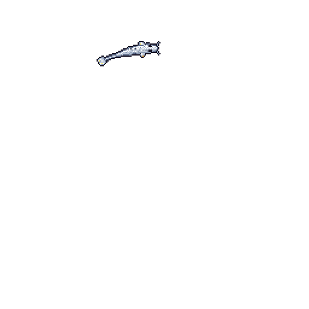

  
  <!-- Rainbow arching across the sky -->
  

    

  <!-- Your Koi -->
  

    

  ### 🌤️ Soaring through the code sky 🌤️

  

    
  

   

  <!-- A flock of birds drifting through the sky -->
  

    🕊️&nbsp;&nbsp;&nbsp;&nbsp;&nbsp;&nbsp;&nbsp;&nbsp;🐦&nbsp;&nbsp;&nbsp;&nbsp;&nbsp;&nbsp;🐦&nbsp;&nbsp;&nbsp;&nbsp;&nbsp;&nbsp;&nbsp;&nbsp;🕊️&nbsp;&nbsp;&nbsp;&nbsp;🐦&nbsp;&nbsp;&nbsp;&nbsp;&nbsp;&nbsp;🐦
  

   

  <!-- Optional short intro -->
  

    Gliding through code, one commit at a time. 
    Exploring the skies of technology 🦅
  

   

  <!-- Sky, birds, and a skyline of tall buildings at the bottom -->
  

